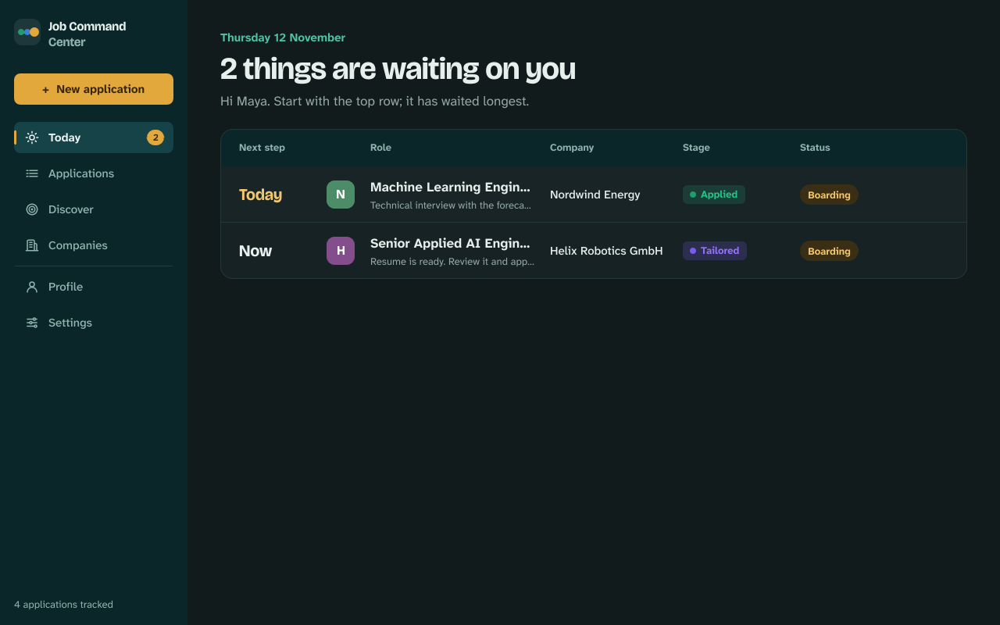
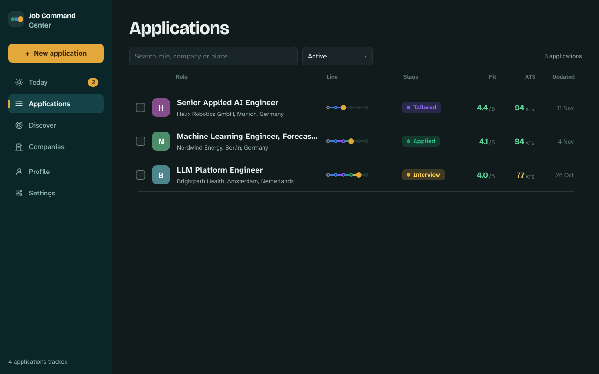
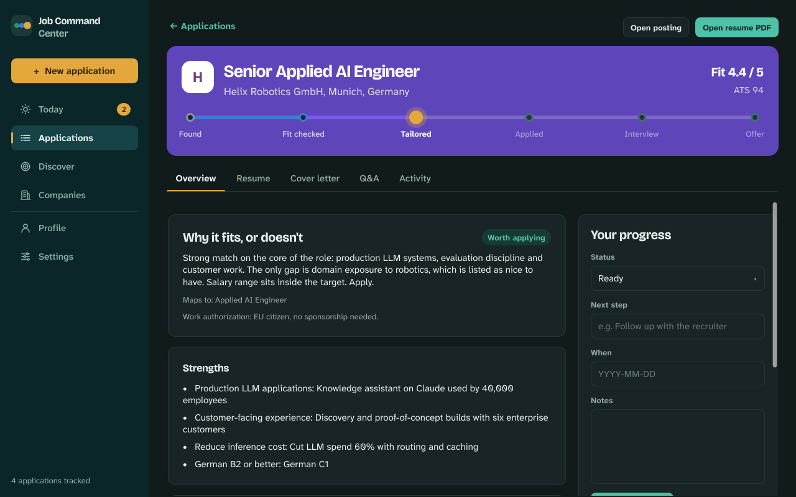
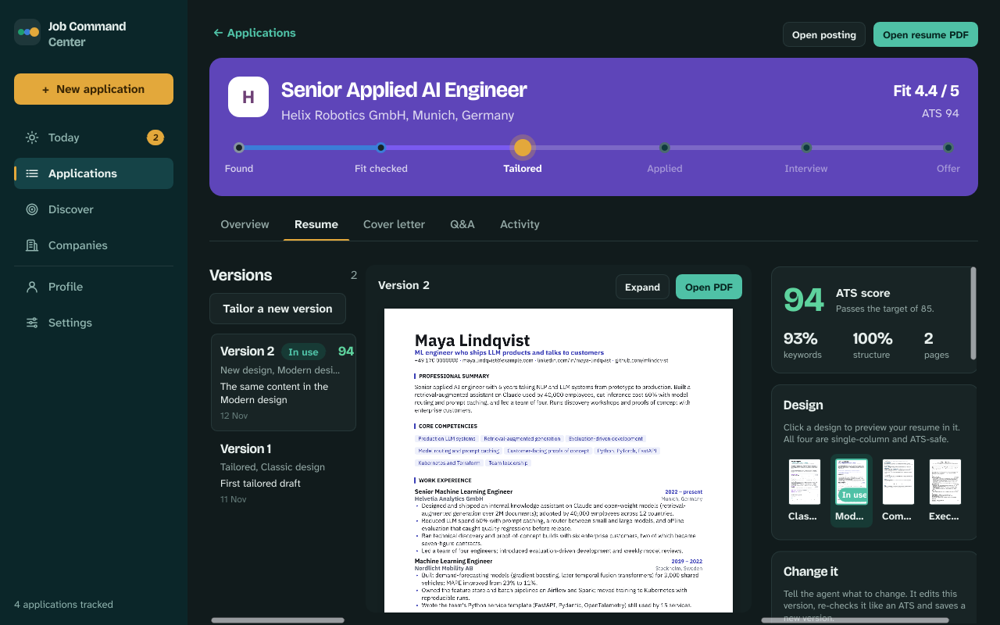
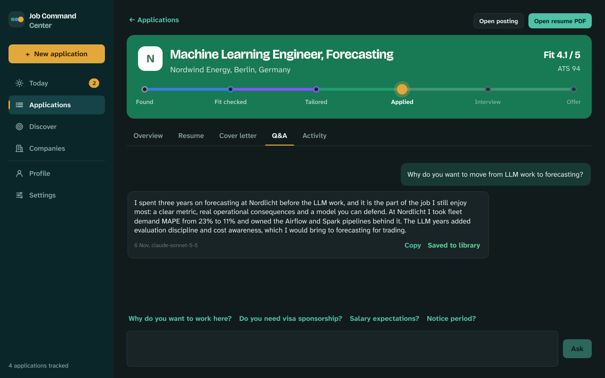
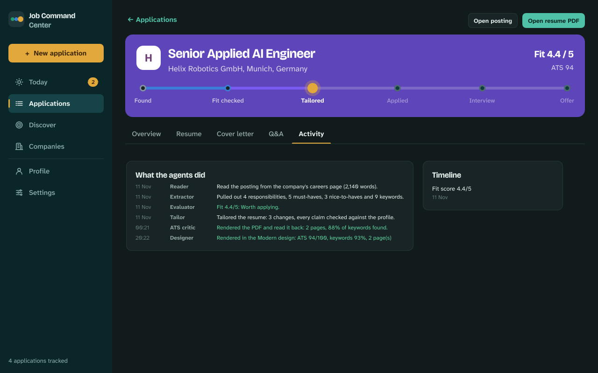
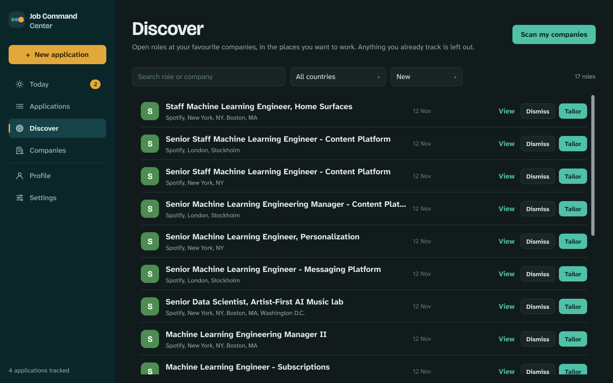
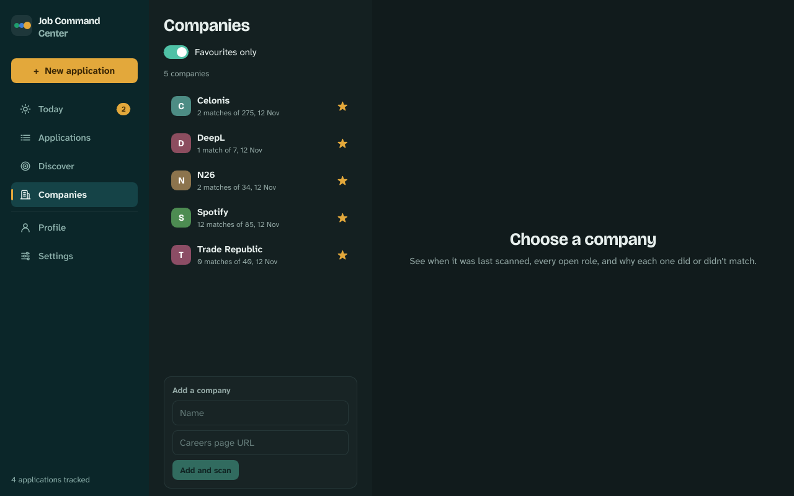
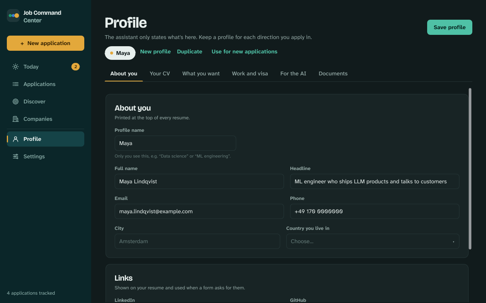
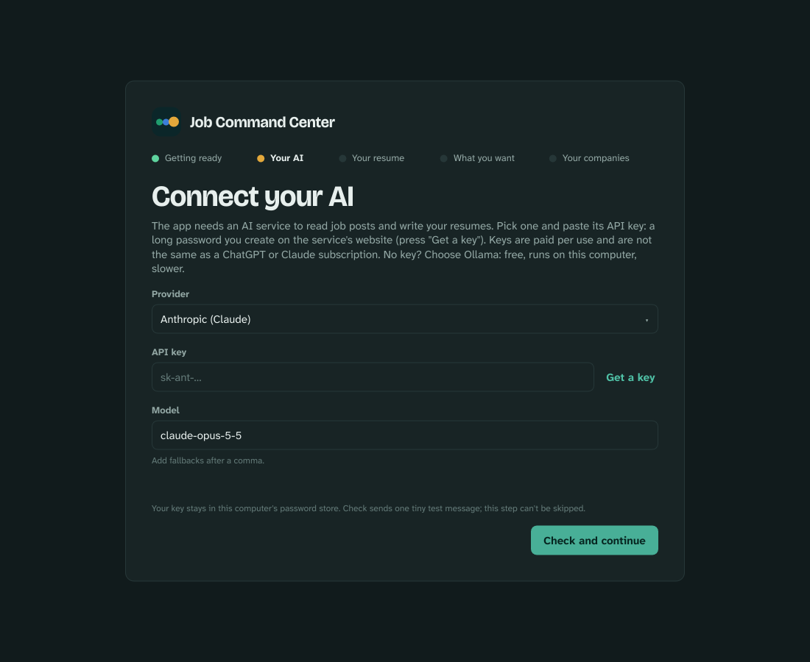

# Job Command Center (desktop)

A native app for Mac, Windows and Linux that turns job postings into honest, tailored applications. Everything runs on your computer; the only thing that goes online is the AI service you connect.

## Get the app (no coding needed)

Download one file, open it, done. Nothing else to install.

**Mac (Apple silicon: M1 or newer; check under  → About This Mac, "Chip")**
1. Download [Job Command Center for Mac](https://github.com/RohithOrg/releases/releases/download/job-command-center-v0.1.2/job-command-center-0.1.2-macos-aarch64.dmg).
2. Open the downloaded file and drag **Job Command Center** onto **Applications**.
3. Open it from Applications. The first time, macOS says it "could not verify" the app: open **System Settings → Privacy & Security**, scroll down and press **Open Anyway**. This happens once.

**Windows 10 / 11**
1. Download [Job Command Center for Windows](https://github.com/RohithOrg/releases/releases/download/job-command-center-v0.1.2/job-command-center-0.1.2-windows-x86_64.exe).
2. Open it. If Windows shows "Windows protected your PC", press **More info**, then **Run anyway**. This happens once.
3. The app opens by itself and appears in the Start menu.

**Linux (Ubuntu, Fedora, most others)**
1. Download [Job Command Center for Linux](https://github.com/RohithOrg/releases/releases/download/job-command-center-v0.1.2/job-command-center-0.1.2-linux-x86_64.AppImage).
2. Right-click the file → Properties → allow it to run as a program (or in a terminal: `chmod +x` the file).
3. Double-click it. On Ubuntu 22.04 or newer, if nothing happens, run `sudo apt install libfuse2` once.
4. Your API key is kept in the desktop's password store (GNOME Keyring or KWallet). Ubuntu, Fedora, Mint and other desktops have one already; if you use a bare window manager without one, install `gnome-keyring` first.

All downloads: [github.com/RohithOrg/releases](https://github.com/RohithOrg/releases/releases). Or install **Hangar**, which installs and updates this app and the rest of the suite for you.

On first launch the app sets itself up (about a minute), then walks you through four things:

1. **Connect an AI** (below).
2. **Your resume**: import your current resume as a PDF or text file. This is the only place the app takes facts from. Every tailored resume, cover letter and answer is built from it, and nothing you don't have is ever added. You can edit it any time under Profile.
3. **What you want**: job titles, countries or cities, and words that rule a job out (for example "Intern"). The fit score and the Discover page use these.
4. **Your companies**: star the companies you'd like to work for. The app checks their job pages for roles that match.

Steps 2 to 4 can be skipped and filled in later under Profile, which also holds work authorisation and visa, salary, languages, your strengths, and extra documents the AI may draw on.

**Connecting an AI**, two ways:
- **Paste an API key** from Anthropic (Claude), OpenAI or Google Gemini. A key is a long password you create on their website; the app has a "Get a key" button that takes you there. It is paid per use, usually cents per resume, and is **not** the same as a ChatGPT or Claude subscription.
- **Free, no account:** install [Ollama](https://ollama.com/download), download a model in it (for example llama3.1), then choose Ollama in the app. Slower and less polished than the paid services.

**Your data stays on your computer.** Your resume, profile, applications and generated PDFs live in one folder on your disk (see "Where your data lives"). The API key goes into the operating system's password store (Keychain, Windows Credential Manager, GNOME Keyring / KWallet), never into a file. The only things that ever leave the computer are the job postings you add and the text the AI needs to read them, and those go only to the AI service you chose. There is no account with this app, no analytics, no server of ours, and nothing is uploaded anywhere else. If you pick Ollama or LM Studio, nothing leaves the computer at all.

Not yet available: Intel Macs.

## What it looks like

Screenshots from a demo profile ("Maya Lindqvist" and the companies she applied to are made up; the Discover roles are real postings found by the scanner).

**Today**: what needs you, oldest first. Interviews that are due, resumes ready to send, agents that stopped.



**Applications**: every job on one line from Found to Offer, with the fit score and the ATS score of the current resume.



**One application**: why it fits or doesn't, strengths and gaps with evidence from your profile, and your own status, next step and notes.



**Resume versions**: the real PDF, its ATS score, four designs to switch between, and a box to tell the agent what to change. Every version is kept.



**Q&A**: paste a question from an application form; the answer uses only your profile and that job's resume. Save the good ones and later applications reuse them.



**Activity**: what each agent did, step by step.



**Discover and Companies**: star companies, and the app checks their job pages for roles that match your titles and places.





**Profile**: the only source the agents may state facts from.



**First run**: connecting an AI.



## How it works

1. Paste a job link (or the posting text). The **Reader** fetches the page; the **Extractor** turns it into requirements and keywords.
2. The **Evaluator** scores the fit against your profile, 1 to 5, with strengths, gaps and red flags. Below 3.0 it stops and tells you why (you can still ask it to tailor anyway).
3. The **Tailor** rewrites your resume for that posting using only facts from your profile. Skills you don't have are never added.
4. The **ATS critic** renders the real PDF, reads it back like an applicant tracking system, and sends it back to the Tailor until the keyword score passes the target (default 85) or three rounds are up.
5. You review, apply, and track the next step. Q&A and the cover-letter writer draw on the same profile and resume.

## What it does

- **Applications**: paste a job link. Agents read the posting, score the fit against your profile, tailor a resume and check it the way an applicant tracking system (ATS) would, by rendering the real PDF and reading it back. Every claim is checked against your profile; skills you don't have are never added.
- **Resume versions**: every draft, revision and design change is kept. Preview the pages in the app, switch between four designs, or tell the agent what to change.
- **Application Q&A**: paste a question from an application form and get an answer from your profile and that job's resume. Save good answers; later applications reuse them.
- **Discover and Companies**: the app checks your favourite companies' job pages for roles that match your titles and places.
- **History**: close applications instead of deleting them. If the same job comes back, by link or by a near-identical description, the app tells you.

## AI providers

Anthropic (Claude), OpenAI, Google Gemini, OpenRouter, Groq, Ollama or LM Studio on your computer, or any OpenAI-compatible URL. API keys are stored in the operating system's password store (Keychain, Windows Credential Manager, Secret Service), never in the app's files.

**Using a gateway (advanced).** Because the app accepts any OpenAI-compatible URL, it also works behind a local AI gateway such as [OmniRoute](https://github.com/cheaper-inference/OmniRoute) (MIT, third party, not affiliated with this project): choose "Custom OpenAI-compatible URL", enter the gateway's address (OmniRoute's default is `http://localhost:20128/v1`) and its key. The gateway then decides which account or provider answers. Check the terms of service of each provider you connect through a gateway; some do not allow their consumer subscriptions to be used from third-party programs, and that is between you and the provider. This app does not include, require or endorse any gateway.

## Use it on your phone

Settings → Phone and web turns on a small website served by the app itself. Scan the QR code on a phone on the same Wi-Fi and enter the passcode shown in the desktop app (it changes every 24 hours). It can be added to the home screen like an app.

To reach it from anywhere, paste an ngrok authtoken and turn on "From anywhere"; the passcode then becomes a longer phrase, and you can optionally limit access to one Google account. AI keys, phone access, the data folder and deleting things can only be changed in the desktop app.

## Where your data lives

| OS | Folder |
|---|---|
| macOS | `~/Library/Application Support/com.JobCommandCenter.Job-Command-Center/` |
| Windows | `%APPDATA%\JobCommandCenter\Job Command Center\data\` |
| Linux | `~/.local/share/jobcommandcenter/` |

It holds one SQLite database and the generated PDFs. Back it up by copying the folder.

## Run from source

No installer needed; one command fetches the Rust toolchain (and on Linux the build libraries) and starts the app. The first build takes a few minutes, later starts a few seconds.

```bash
git clone https://github.com/RohithOrg/job-command-center.git && cd job-command-center/app
make up                        # macOS and Linux (or ./scripts/start.sh)
powershell -ExecutionPolicy Bypass -File scripts\start.ps1   # Windows
```

## For developers

```bash
cargo run                      # debug build
cargo test                     # unit tests (add -- --include-ignored for live network tests)
./scripts/macos-bundle.sh      # local .app + .dmg
cargo packager --release       # installers for the current OS (cargo install cargo-packager)
```

Pushing a tag like `v0.1.0` runs `.github/workflows/desktop.yml`, which builds all installers and attaches them to a GitHub release. Linux builds need `libxkbcommon-dev libfontconfig1-dev libdbus-1-dev`.

| Part | Where |
|---|---|
| Window and screens (Slint) | `ui/` |
| AI providers | `src/ai.rs` |
| Agent pipeline and ATS loop | `src/pipeline.rs`, `src/ats.rs`, `src/prompts.rs`, `rules/` |
| Document library and search | `src/rag.rs`, `src/embed.rs` (all-MiniLM-L6-v2, bundled) |
| Q&A | `src/chat.rs` |
| Resume PDFs and previews (Typst) | `src/pdf.rs`, `templates/` |
| Reading postings, scanning career sites | `src/fetch.rs`, `src/scanner.rs`, `catalog.json` |
| Storage | `src/db.rs` |

Debug builds accept `JCC_DATA_DIR=<folder>` to use a separate data folder, and `--cli <command>` to run the agents without the window (`set-ai`, `test-ai`, `run <url>`, `ask <id> <question>`, `revise`, `restyle`, `index`, `search`).

## Licenses

App: MIT. Bundled: all-MiniLM-L6-v2 (Apache-2.0), Source Sans 3, IBM Plex Sans, Libertinus Serif, Bricolage Grotesque, Atkinson Hyperlegible Next (SIL OFL 1.1). Job titles and skills suggestions come from ESCO (European Commission); city suggestions from Open-Meteo.
